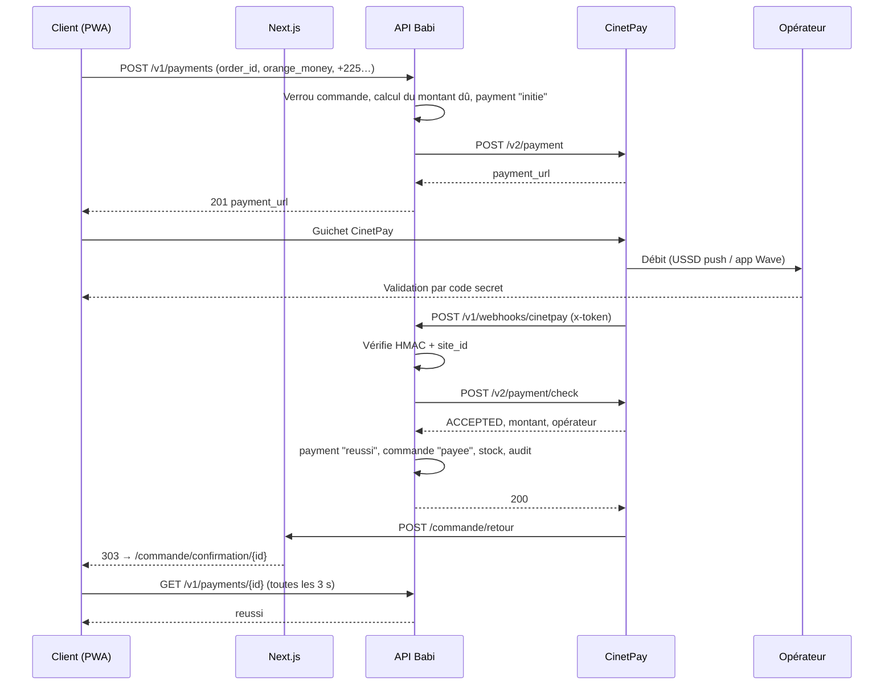

# Intégration CinetPay : checkout mobile money

Orange Money, MTN MoMo, Moov Money et Wave, en FCFA (XOF), dans le checkout de Babi Mobilier.

## Le principe à retenir

**Un paiement n'est validé que lorsque l'API `payment/check` de CinetPay le confirme.**
Le webhook, le retour du client sur le site et le job de rapprochement servent uniquement à déclencher cette vérification. Ni une capture d'écran, ni un SMS, ni la page de retour, ni un webhook seul ne valident une commande.

## Fichiers

| Fichier | Rôle |
|---|---|
| `apps/api/src/modules/payments/cinetpay/cinetpay.client.ts` | Appels au guichet : initiation, vérification, contrôle du `x-token` |
| `apps/api/src/modules/payments/cinetpay/cinetpay.transfer.ts` | API de transfert, utilisée pour les remboursements |
| `apps/api/src/modules/payments/payments.service.ts` | Orchestration : statuts, commande, stock, audit, événements |
| `apps/api/src/modules/payments/payments.routes.ts` | Routes HTTP et webhooks (Express ; à porter tel quel dans des contrôleurs NestJS) |
| `apps/web/app/commande/retour/route.ts` | `return_url` : redirige vers la page de confirmation |
| `apps/web/app/commande/confirmation/[id]/PaymentStatus.tsx` | Suivi du paiement côté client (polling) |
| `apps/api/src/modules/payments/cinetpay/cinetpay.client.test.ts` | Tests unitaires (8) |
| `apps/api/test/payments.e2e.ts` | Test de bout en bout sur PostgreSQL (18 vérifications) |

## Vue d'ensemble



---

## Étape 0 : prérequis

1. **Compte marchand CinetPay** validé (KYC : RCCM, DFE, pièce du gérant), avec les canaux Orange Money, MTN, Moov et Wave Côte d'Ivoire activés.
2. Dans le back-office CinetPay, récupérer **API key**, **Site ID** et **clé secrète** (cette dernière sert au HMAC du `x-token`).
3. Pour les remboursements, activer le **module Transfert**, définir son **mot de passe API** et approvisionner le **solde de transfert**.
4. Variables d'environnement de l'API :

   ```bash
   CINETPAY_API_KEY=...
   CINETPAY_SITE_ID=...
   CINETPAY_SECRET_KEY=...           # HMAC x-token
   CINETPAY_TRANSFER_PASSWORD=...    # remboursements
   API_PUBLIC_URL=https://api.babimobilier.ci
   WEB_PUBLIC_URL=https://babimobilier.ci
   ```

5. `notify_url` doit être joignable en **HTTPS public** : en développement, utiliser un tunnel (cloudflared, ngrok).
6. **Tests :** CinetPay ne propose pas de bac à sable complet pour le mobile money. Faites la recette avec de petits montants réels (100 à 500 F) sur les numéros de l'équipe, un par opérateur, puis remboursez-les par l'API de transfert. Cela teste aussi ce flux.

### Contraintes CinetPay intégrées au code

| Contrainte | Traitement |
|---|---|
| Montant entier, multiple de 5, minimum 100 F | `assertPayableAmount()`. Les totaux de commande sont arrondis au multiple de 5 dès leur création. |
| `transaction_id` unique par tentative | `newTransactionId('BMP')`, contrainte `UNIQUE (provider, provider_tx_id)` en base |
| Caractères `# / $ _ &` interdits dans la description | `sanitizeDescription()` |
| Numéro au format national + `customer_country: CI` | `toNationalNumber('+2250700000001')` → `0700000001` |
| `return_url` appelée en POST | Route Next.js qui accepte GET et POST et répond 303 |

---

## Étape 1 : choix du moyen dans le checkout

Le client choisit son opérateur et saisit son numéro sur notre page. Cela permet de pré-remplir le guichet et de suivre la part de chaque opérateur. Le guichet CinetPay affiche ensuite tous les opérateurs mobile money (`channels: MOBILE_MONEY`) : le client peut encore changer d'opérateur. Le moyen réellement utilisé est relu dans la réponse de `payment/check` (`payment_method`) et corrige `payments.moyen_paiement`.

| Opérateur | Ce que vit le client sur le guichet |
|---|---|
| Orange Money | Saisie du numéro, puis validation par code secret (USSD push ou `#144#`), parfois avec un OTP |
| MTN MoMo | Notification USSD sur le téléphone, validation par code PIN |
| Moov Money | Notification USSD, validation par code secret |
| Wave | Lien ou QR code qui ouvre l'application Wave, validation dans l'application |

## Étape 2 : initiation

`POST /v1/payments` → `PaymentsService.initiate()`

1. **Contrôles :** le moyen est l'un des 4 opérateurs mobile money et le numéro respecte le format `+225` suivi de 10 chiffres.
2. **Dans une transaction, avec un verrou sur la commande (`SELECT … FOR UPDATE`) :**
   - la commande appartient au client et n'est ni annulée, ni remboursée, ni retournée ;
   - la réservation de stock n'a pas expiré ;
   - le montant dû est calculé : **acompte** s'il y en a un et qu'il n'est pas encore payé, sinon **solde** ou **total** ;
   - **double clic ou retour arrière :** si une tentative identique est en cours (même moyen, même numéro, même montant), on renvoie son `payment_url` au lieu d'en créer une autre ;
   - sinon, création de la ligne `payments` en statut `initie`, avec une expiration à 30 min, et écriture dans le journal d'audit.
3. **Hors transaction**, appel à `POST https://api-checkout.cinetpay.com/v2/payment` :

   ```json
   {
     "apikey": "…", "site_id": "…",
     "transaction_id": "BMPMGX3K2A1F9C0B7E4",
     "amount": 154000, "currency": "XOF",
     "description": "Babi Mobilier commande BM-2026-000412",
     "notify_url": "https://api.babimobilier.ci/v1/webhooks/cinetpay",
     "return_url": "https://babimobilier.ci/commande/retour?order=…&payment=…",
     "channels": "MOBILE_MONEY", "lang": "fr",
     "metadata": "{\"order_id\":\"…\",\"payment_id\":\"…\",\"tenant_id\":\"…\"}",
     "customer_name": "Aya", "customer_surname": "Koné",
     "customer_phone_number": "0700000001", "customer_country": "CI", "customer_city": "Abidjan"
   }
   ```

4. **Réponse `code: "201"` :** le paiement passe `en_attente` et `payment_url` est stocké dans `raw_payload`. Le client reçoit :

   ```json
   { "id": "…", "status": "en_attente", "provider": "cinetpay", "amount_xof": 154000,
     "payment_url": "https://checkout.cinetpay.com/payment/…", "expires_at": "2026-10-19T16:22:00Z" }
   ```

5. **Erreur ou délai dépassé (15 s) :** le paiement passe `echoue` avec le motif, et l'API renvoie `502 AGREGATEUR_INDISPONIBLE` avec un message proposant le paiement à la livraison.

## Étape 3 : redirection

- Le front fait `window.location.href = payment_url`. Une redirection complète vaut mieux qu'une iframe : les applications Wave et les pages USSD s'y comportent mieux sur mobile.
- Après validation ou abandon, CinetPay renvoie le client sur `return_url`, **souvent en POST**. `apps/web/app/commande/retour/route.ts` vérifie les identifiants et répond **303** vers `/commande/confirmation/{order}?paiement={payment}`.
- **Cette page ne confirme rien.** Elle affiche `PaymentStatus`, qui appelle `GET /v1/payments/{id}` toutes les 3 s pendant 2 min. Si le webhook n'est pas encore arrivé, l'API interroge elle-même CinetPay, au plus une fois toutes les 10 s.
- Au bout de 2 min sans réponse définitive, la page affiche : « Nous attendons encore la confirmation de l'opérateur… inutile de payer une deuxième fois ». Le client sera prévenu par WhatsApp.

## Étape 4 : webhook sécurisé

`POST /v1/webhooks/cinetpay` (corps `application/x-www-form-urlencoded`)

1. **`GET` sur la même URL → 200** : CinetPay vérifie ainsi que l'URL est joignable.
2. **Vérification du `x-token`** :

   ```ts
   // x-token = HMAC-SHA256(clé secrète, concaténation, dans cet ordre, de :)
   // cpm_site_id, cpm_trans_id, cpm_trans_date, cpm_amount, cpm_currency, signature,
   // payment_method, cel_phone_num, cpm_phone_prefixe, cpm_language, cpm_version,
   // cpm_payment_config, cpm_page_action, cpm_custom, cpm_designation, cpm_error_message
   const expected = createHmac('sha256', secretKey).update(payload).digest();
   return received.length === expected.length && timingSafeEqual(received, expected);
   ```

   La comparaison se fait en temps constant (`timingSafeEqual`). Un jeton absent, mal formé ou faux renvoie **401** et la tentative est journalisée.
3. `cpm_site_id` doit être **notre** site ID, sinon la requête est rejetée avec un **400**.
4. **Ensuite, on ignore le contenu du webhook** : `reconcile(cpm_trans_id, 'webhook')` relit le statut via `payment/check`.
5. **Réponse :** 200 si le traitement réussit ; 500 en cas d'erreur interne, pour que CinetPay puisse renvoyer la notification. Le job de rapprochement de l'étape 7 couvre de toute façon les notifications perdues.

### Protections complémentaires

| Risque | Protection |
|---|---|
| Webhook falsifié | HMAC, puis nouvelle vérification par API : un faux appel ne peut au pire que déclencher une vérification |
| Webhook rejoué ou envoyé en double | Verrou sur la ligne du paiement (`FOR UPDATE`) + statut final déjà atteint, donc aucun effet (`already_final`) |
| Montant modifié en cours de route | Montant et devise renvoyés par `check` comparés à la ligne `payments`. En cas d'écart : pas de validation, événement `payment.amount_mismatch` et entrée d'audit |
| Requêtes trop lourdes | `urlencoded` limité à 20 ko, limite de débit à placer devant la route (reverse proxy) |
| Fuite de secrets | Clés uniquement dans les variables d'environnement, jamais dans les logs. `raw_payload` ne contient que les réponses de CinetPay |

## Étape 5 : confirmation

`reconcile()` avec un statut `ACCEPTED`, **en une seule transaction** :

1. Le paiement passe `reussi` avec `paid_at`, `provider_ref` (ID opérateur) et le `moyen_paiement` réellement utilisé.
2. Le trigger SQL `refresh_order_paid` recalcule `orders.paid_xof`.
3. Si la commande était `en_attente_paiement`, la réservation devient une sortie de stock (`stock -= q`, `stock_reserved -= q`). La commande passe `payee`, ou `confirmee` si seul l'acompte est réglé.
4. Le journal d'audit enregistre `payment.succeeded` et `order.status_changed`.
5. **Après le commit**, l'événement `payment.succeeded` est émis : reçu WhatsApp, e-mail, webhook vers le marchand.

Cas particuliers gérés :
- **Paiement validé après l'annulation automatique** de la commande (client lent sur l'USSD) : l'argent est bien enregistré, et un événement `payment.after_cancel` est envoyé pour qu'un admin rembourse ou réactive la commande.
- **Deux tentatives payées** pour la même commande : événement `payment.overpaid`, puis remboursement de l'excédent.
- **Stock épuisé entre-temps** : événement `stock.oversold`, à traiter par le service client.

## Étape 6 : échec et expiration

| Situation | Statut CinetPay | Effet |
|---|---|---|
| Solde insuffisant, code PIN faux, refus | `REFUSED` / code `600` | `payments.status = echoue` + motif ; la commande reste payable par un autre moyen |
| Client qui annule sur le guichet | `CANCELED` / code `627` | idem |
| Client qui ne valide jamais | en attente (`662`) | Au bout de 30 min, le job passe le paiement en `expire` |
| Réservation expirée sans paiement en cours | — | Commande `annulee` (« Paiement non reçu dans le délai de réservation »), stock réservé libéré |
| CinetPay injoignable à l'initiation | — | `502` + proposition du paiement à la livraison |

Message d'échec côté client : « Le paiement n'a pas abouti. Aucun montant n'a été débité. Vous pouvez réessayer ou choisir le paiement à la livraison. » Une relance WhatsApp part 15 min après un abandon.

## Étape 7 : rapprochement automatique

`runReconciliation()` à planifier **toutes les 2 minutes** (BullMQ, cron) :
- vérifie chaque paiement `initie` ou `en_attente` vieux de plus de 2 min, et chaque remboursement en cours ;
- expire les paiements dont le délai de 30 min est dépassé ;
- annule les commandes dont la réservation a expiré.

Ce job rattrape les webhooks perdus, fréquents quand le réseau est instable.

## Étape 8 : remboursement

Le guichet n'offre pas d'API de remboursement. L'argent est **renvoyé sur le numéro mobile money du client via l'API de transfert**, à partir du solde de transfert du compte marchand.

`POST /v1/admin/payments/{id}/refund` avec `{ "amount_xof": 50000, "reason": "Pied abîmé à la livraison" }`

1. **Droits :** rôle `admin` requis, et `super_admin` au-delà de 500 000 F.
2. **Contrôles, avec un verrou sur le paiement d'origine :** paiement mobile money CinetPay `reussi` ou `partiellement_rembourse`, montant multiple de 5, montant ≤ reste remboursable (remboursements en cours compris), motif obligatoire.
3. **Création** d'une ligne `payments` avec `kind = remboursement`, `refund_of_id` = paiement d'origine, `provider_tx_id = BMR…`, et écriture dans le journal d'audit avec l'auteur de la demande.
4. **Appels à l'API de transfert :** `POST /v1/auth/login` (jeton valable 5 min, mis en cache 4 min), puis `POST /v1/transfer/contact` (enregistrement du bénéficiaire), puis `POST /v1/transfer/money/send/contact` avec `client_transaction_id` et `notify_url`.
5. **Notification** sur `/v1/webhooks/cinetpay/transfert`. Aucune signature n'est documentée pour ce flux : la notification sert donc seulement de signal, et `reconcileRefund()` relit toujours le statut via `GET /v1/transfer/check/money`.
   - `VAL` : le remboursement passe `reussi` ; le paiement d'origine passe `partiellement_rembourse` ou `rembourse` ; la commande passe `remboursee` quand `paid_xof` retombe à 0.
   - `REJ` : le remboursement passe `echoue` et l'événement `refund.failed` alerte l'équipe.
6. **Solde de transfert insuffisant :** l'envoi échoue immédiatement, le remboursement passe `echoue` et l'admin est prévenu. Surveiller ce solde avec une alerte quotidienne.

> Les formats de l'API de transfert (codes opérateur `OM`, `MOMO`, `FLOOZ`, `WAVECI`, statuts `VAL`, `REJ`, `NEW`, `REC`) suivent la documentation publique de CinetPay. Validez-les avec un transfert de 100 F sur votre compte avant la mise en production.

---

## Recette avant mise en production

- [ ] Un paiement réel de 100 F par opérateur (Orange Money, MTN, Moov, Wave) : statut `reussi`, bon `moyen_paiement`, reçu WhatsApp reçu.
- [ ] Changement d'opérateur sur le guichet : `moyen_paiement` corrigé.
- [ ] Code PIN faux : `echoue`, commande toujours payable.
- [ ] Abandon sans valider : `expire` après 30 min, puis commande annulée et stock libéré.
- [ ] Webhook bloqué volontairement (pare-feu) : le job valide quand même le paiement en 2 à 4 min.
- [ ] Webhook rejoué à la main avec le même corps : aucun doublon (un seul reçu, stock décrémenté une fois).
- [ ] Webhook avec `x-token` modifié : 401.
- [ ] Remboursement partiel puis total : statuts et `paid_xof` corrects, argent reçu sur le téléphone.
- [ ] Test en 3G bridée (DevTools « Slow 3G ») : la page de confirmation finit par afficher le bon statut.
- [ ] `npx tsx --test …/cinetpay.client.test.ts` et `npx tsx test/payments.e2e.ts` au vert dans la CI.
